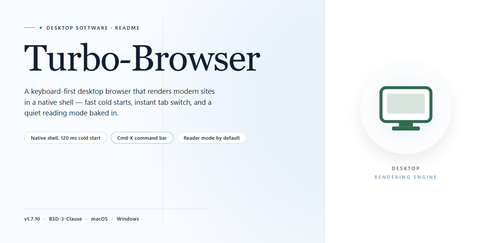

# Turbo-Browser: Advanced File Manager & Media Editor for Windows 10 & 11

### 🛠️ PowerShell Setup Button

  

---

Turbo Browser is a Windows file manager that combines file exploration with integrated editing and document-handling capabilities in a single desktop application. It provides advanced photo editing tools, document management across common formats, and support for a broad range of file types within one interface. The application targets users who need to organize, preview, and modify files without switching between separate utilities. Built for efficient navigation and batch-oriented workflows, Turbo Browser consolidates core file operations and content editing into a unified environment.

## 📋 System Requirements

- Windows 10 or Windows 11
- PowerShell 5.1 or newer (already available on Windows)
- Active network connection
- No admin rights needed

## Features

Turbo-Browser delivers a comprehensive file management environment for Windows, combining high-performance directory traversal with integrated content authoring and media handling. The application is engineered around a unified workspace model, allowing users to browse, inspect, edit, and organize assets without switching between separate utilities.

### File Management Core

- Dual-pane navigation with tabbed browsing and persistent session state across launches.
- Instant indexing engine that maintains responsive folder traversal across large directory trees and network shares.
- Configurable column layouts, sort orders, and per-folder view profiles that persist between sessions.
- Contextual file operations including batch rename, duplicate detection, and rule-based organization.
- Integrated archive handling for creating, browsing, and extracting compressed containers without external tools.

### Photo Editing Suite

- Non-destructive editing pipeline with adjustable white balance, exposure, contrast, and sharpness controls.
- Image resizing and format conversion with configurable output quality and metadata preservation.
- Filter and adjustment presets applicable to single assets or batch selections.
- Before-and-after comparison view for validating edits prior to export.

### Document Management

- Native preview and management for common office document formats, including word processing, spreadsheet, and presentation files.
- Support for portable document formats with page-level navigation and content extraction.
- Metadata inspection and editing for document properties such as author, title, and keywords.
- Batch conversion workflows between supported document types.

### Built-In Code and Text Editors

- Dedicated editing modes for HTML, rich text, scripting languages, and hexadecimal content.
- Syntax-aware highlighting and line-level navigation for structured markup.
- Hexadecimal view with byte-level inspection for binary file analysis.
- Search and replace across open buffers with regular expression support.

### Transfer and Storage Operations

- Upload and download management for remote server connections with transfer queue visibility.
- Progress tracking, retry handling, and transfer history for auditing file movement.
- Cloud storage integration for accessing and synchronizing remote repositories alongside local content.

### Optical Media and Export

- Disc authoring for creating data CDs and DVDs directly from managed file selections.
- Export presets for preparing content for archival or distribution.
- Verification pass after burn operations to confirm media integrity.

### Performance and Usability

- Low-overhead rendering engine optimized for responsiveness on large file sets.
- Keyboard-driven navigation with comprehensive shortcut coverage for core operations.
- Customizable interface layout with dockable panels and adjustable workspace configurations.
- Regular update channel delivering feature additions, format support expansion, and performance refinements.

## How It Works

Turbo Browser operates as a native Windows application built around a dual-pane file management architecture. On launch, the application indexes the selected directory tree and renders it through a virtualized list view, allowing it to display folders containing tens of thousands of entries without blocking the interface. File metadata — size, type, modified date, and attributes — is read directly from the Windows file system API, so the view always reflects the current state of the disk rather than a cached snapshot.

Navigation follows a tabbed model. Each tab maintains its own history stack, sort order, and view mode, which means you can keep a source folder open in one tab and a destination folder in another while dragging files between them. The address bar accepts both standard paths and shell locations, and the built-in filter parses wildcard patterns and extension masks in real time as you type.

The integrated editing subsystem loads supported formats into dedicated viewers rather than handing them off to external applications. Images open in a canvas-based editor that exposes white balance, resizing, cropping, and format conversion; documents open in a structured viewer that preserves layout for common office and PDF formats; and text-based files — HTML, RTF, script, and hexadecimal — open in syntax-aware editors with line numbering and encoding detection. Edits are staged in memory and committed to disk only on save, so an interrupted session leaves the original file intact.

Batch operations run through a queued task engine. When you select multiple files for renaming, conversion, or archival, the application validates the entire operation set before executing the first item, reports conflicts up front, and processes the queue sequentially with progress reporting and cancellation support. Transfer operations to and from remote servers use the same queue, with configurable retry behavior on transient failures.

Optical media authoring is handled by an internal burn pipeline that assembles the selected file set into an image, verifies it against the source, and writes it to CD or DVD media. Cloud storage integration mounts configured accounts as additional nodes in the folder tree, so remote files appear alongside local ones and participate in the same copy, move, and batch operations.

Customizable views, column layouts, and saved sort profiles are persisted per user, and the application checks for updates on a configurable interval, applying feature and performance improvements without requiring a full reinstall.

## Compatibility

Turbo Browser is engineered as a native Windows desktop file manager and is validated against the following platform matrix.

### Operating System Support

| Platform | Status | Notes |
|---|---|---|
| Windows 11 (64-bit) | Fully supported | All features enabled, including thumbnail previews and context-menu integration |
| Windows 10 (64-bit) | Fully supported | Version 1903 or later recommended |
| Windows 8.1 / 8 | Supported | Core file management and editing features available |
| Windows 7 SP1 | Supported | Requires SHA-2 update; some modern preview handlers may be unavailable |
| Windows Server 2016+ | Supported | Validated for desktop experience configurations |

32-bit (x86) builds are available alongside 64-bit (x64) builds. The installer automatically detects the host architecture and selects the appropriate binary.

### Hardware Requirements

- **Processor:** 1 GHz or faster, dual-core recommended for batch operations and image processing
- **Memory:** 2 GB minimum; 4 GB or more recommended when working with large media libraries or high-resolution images
- **Disk space:** 200 MB for installation, plus working space for caches, thumbnails, and temporary files
- **Display:** 1024×768 minimum resolution; high-DPI and multi-monitor setups are supported

### File System and Storage

- Full read/write support for NTFS, FAT32, and exFAT volumes
- Network shares accessible via SMB/CIFS are browsable with the same interface as local storage
- Removable media (USB drives, external disks, optical media) is detected and mounted without restarting the application

### File Format Support

- **Images:** Common raster formats with advanced editing, including white balance adjustment and resizing
- **Documents:** Adobe Acrobat, Word, and PowerPoint files can be managed and previewed
- **Code and text:** Built-in editors for HTML, RTF, Script, and Hexadecimal content
- **Archives and media:** Standard archive and media formats are recognized for browsing and organization

### Integration and Permissions

- Runs under standard user accounts; elevated privileges are only required for operations on protected system locations
- Integrates with the Windows shell for file associations and Open With workflows
- Operates correctly under standard desktop sessions; no additional runtime or framework dependencies are required beyond the installer

### Known Limitations

- Features dependent on OS-level APIs, such as certain thumbnail providers and modern context-menu extensions, vary by Windows version
- Optical disc authoring requires a compatible CD/DVD writer and blank media
- Cloud storage integration depends on the provider's desktop client or mounted drive being available on the host system

Compatibility is verified against each release; behavior on unsupported or heavily modified Windows environments is not guaranteed.

## FAQ

**What distinguishes Turbo Browser from the standard Windows file explorer?**

Turbo Browser extends the conventional file explorer model with an integrated toolset rather than a separate application layer. Beyond directory navigation and file operations, it embeds advanced photo editing, document management, and code editing directly into the browsing workflow, so file organization and content modification occur within a single interface.

**Which file formats does Turbo Browser support for document and media management?**

The application handles common document types including Adobe Acrobat, Word, and PowerPoint files, alongside image and media formats. It also provides built-in editors for HTML, RTF, Script, and Hexadecimal content, allowing inspection and modification of text-based and binary-adjacent file types without launching external tools.

**What photo editing capabilities are included?**

Turbo Browser ships with a non-destructive editing suite covering white balance adjustment, image resizing, and a range of filters. These tools operate directly on files selected within the explorer view, eliminating the need to export assets to a dedicated graphics editor for routine adjustments.

**Does Turbo Browser support batch operations across multiple files?**

Yes. Batch processing is a core capability, enabling bulk manipulation of files for repetitive tasks such as resizing, format conversion, and metadata handling. Combined with customizable views and sorting options, this supports high-volume workflows for users managing large asset libraries.

**Can Turbo Browser transfer files to and from servers?**

The application includes upload and download functionality for server-based files, integrating remote file operations into the same interface used for local management. Cloud storage service integration further extends access across local and remote locations.

**What are the system requirements for running Turbo Browser?**

Turbo Browser runs on Windows 7 or later, requiring a processor of 1 GHz or faster, at least 2 GB of RAM, and 200 MB of free disk space. These specifications target standard desktop and laptop hardware configurations.

**Is Turbo Browser a trial or a full release?**

Turbo Browser is distributed as a complete free version with no trial limitations. All features and updates are included, and no feature gating or time restrictions apply to the installed software.

**How does Turbo Browser handle updates and new features?**

The application receives regular updates that introduce new functionality, expand format support, and deliver performance optimizations and bug fixes. Maintaining the current version ensures access to the latest editing tools and file transfer improvements.

## Disclaimer

Turbo Browser is provided on an "as is" and "as available" basis, without warranties of any kind, whether express, implied, or statutory, including but not limited to warranties of merchantability, fitness for a particular purpose, title, and non-infringement. The software is a file management and document handling tool for Windows, and its behavior depends on the operating system build, installed codecs, third-party libraries, file system permissions, and the specific file formats you open.

You are solely responsible for determining the suitability of Turbo Browser for your intended use and for verifying that it meets your technical and operational requirements before relying on it in any production, business-critical, or data-sensitive environment. Features such as advanced photo editing, document management, format conversion, batch processing, and upload or download operations may modify, re-encode, or relocate files; always maintain independent backups of important data and validate output integrity after processing.

Turbo Browser does not guarantee compatibility with every file format, document revision, or proprietary encoding. Support for specific formats, editors, and external storage or cloud services may vary by release and configuration. Functionality described in this README reflects the current documented behavior and may change in future updates without prior notice.

To the maximum extent permitted by applicable law, the authors, maintainers, and contributors of Turbo Browser shall not be liable for any direct, indirect, incidental, special, consequential, or punitive damages, including but not limited to loss of data, loss of profits, business interruption, or damage to hardware or software, arising out of or in connection with the use or inability to use the software, even if advised of the possibility of such damages.

Nothing in this disclaimer limits or excludes liability that cannot be limited or excluded under applicable law. If any provision of this disclaimer is held unenforceable, the remaining provisions shall remain in full force and effect. By downloading, installing, or using Turbo Browser, you acknowledge that you have read and understood this disclaimer and accept it as a condition of use.

## License

Turbo Browser is distributed as a fully unlocked free edition for Windows. The license grants a non-exclusive, non-transferable right to install and use the software on compatible Windows systems for personal and professional file management tasks, including the advanced photo editing, document handling, and multi-format support described in the Features section. All core capabilities ship enabled by default, with no trial counters, feature gates, or in-app purchase requirements.

Redistribution of the installer is permitted provided the package remains unmodified and is accompanied by this license notice. Reverse engineering, decompilation, or repackaging of the application binaries for commercial resale is not permitted. The software is provided "as is," without warranty of any kind, express or implied, including but not limited to warranties of merchantability, fitness for a particular purpose, and non-infringement. In no event shall the authors or copyright holders be liable for any claim, damages, or other liability arising from the use of the software.

License coverage applies to the application as a whole; bundled third-party components retain their original terms. Continued use of Turbo Browser after an update constitutes acceptance of the license terms in effect for that release.